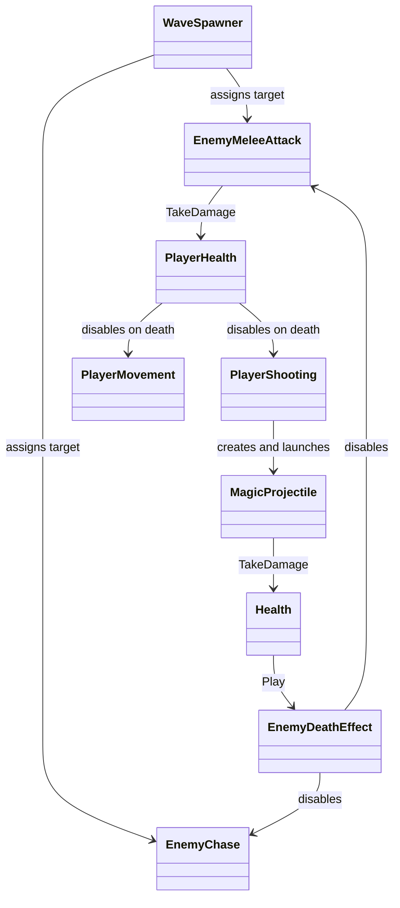
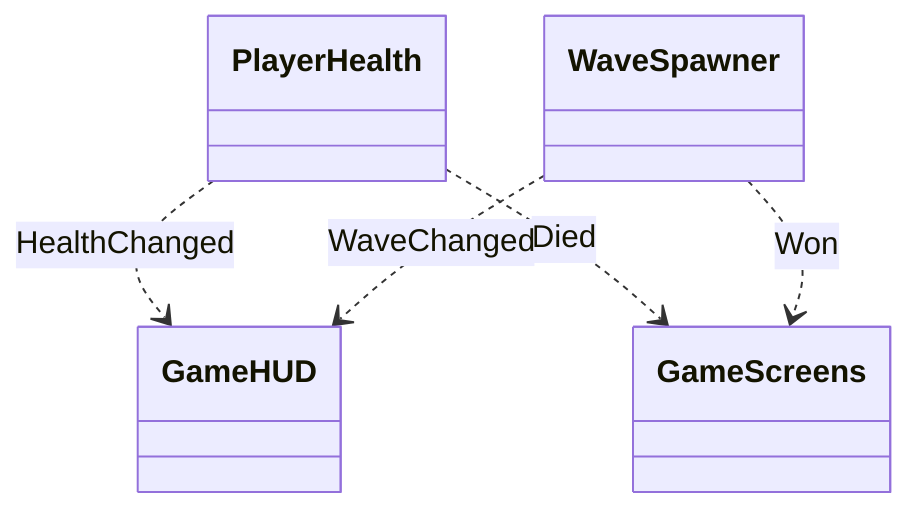

# Frieren: Demon Hunt

A 2D top-down combat prototype built in Unity. Play as Frieren and survive three waves of melee demons in a forest arena.

**Repository:** https://github.com/CS-Ariel-GameDev-Project/Frieren-Demon-Hunt

**Web version:** Not published yet.

## Running the game

1. Open the project using Unity **6000.3.25f1**.
2. Wait for Unity to restore the project packages.
3. Open `Assets/Scenes/Stage1_Forest.unity`.
4. Press Play, then click Start.

## Controls and objective

| Input | Action |
|---|---|
| WASD or arrow keys | Move |
| Mouse | Aim |
| Hold left mouse button | Shoot |
| Start | Begin playing |
| Play Again | Reset the scene and return to the opening screen |

The player starts with 3 HP and receives one second of invulnerability after taking damage.

Clear three waves containing 3, 5, and 7 enemies to win. Reaching zero HP causes defeat. The next wave begins after all enemies and their death effects have disappeared.

Trees, rocks, and arena borders block movement. Projectiles hit enemies and obstacles but ignore arena borders. Defeated enemies spin and fly backward before disappearing.

## Code organization

| Folder | Components |
|---|---|
| `Assets/Scripts/Player` | `PlayerMovement`, `PlayerShooting`, `PlayerHealth` |
| `Assets/Scripts/Combat` | `MagicProjectile`, `Health` |
| `Assets/Scripts/Enemies` | `EnemyChase`, `EnemyMeleeAttack`, `EnemyDeathEffect` |
| `Assets/Scripts/Stage` | `WaveSpawner` |
| `Assets/Scripts/UI` | `GameHUD`, `GameScreens` |

Prefabs are stored under `Assets/Prefabs`, sprites under `Assets/Art`, and scenes under `Assets/Scenes`.

## Current class relationships

Each component has a focused responsibility:

- `PlayerMovement` reads keyboard input and applies physics movement.
- `PlayerShooting` aims and creates projectiles.
- `PlayerHealth` manages player HP, immunity, and death.
- `MagicProjectile` handles projectile movement and impacts.
- `Health` manages enemy HP.
- `EnemyChase` moves directly toward the player.
- `EnemyMeleeAttack` attempts close-range damage at timed intervals.
- `EnemyDeathEffect` handles death spin, knockback, and removal.
- `WaveSpawner` creates enemies and advances waves.
- `GameHUD` displays health and wave progress.
- `GameScreens` displays opening and result panels.

The following diagram shows direct component calls and dependencies:

## Events and UI communication

Gameplay components publish events without holding references to UI components.

| Publisher | Event | Subscriber |
|---|---|---|
| `PlayerHealth` | `HealthChanged(current, maximum)` | `GameHUD` updates HP |
| `PlayerHealth` | `Died()` | `GameScreens` displays defeat |
| `WaveSpawner` | `WaveChanged(current, total)` | `GameHUD` updates wave progress |
| `WaveSpawner` | `Won()` | `GameScreens` displays victory |

Listeners subscribe in `OnEnable` and unsubscribe in `OnDisable`. The HUD also reads current values when activated to display the initial state and recover updates missed while disabled.

`GameScreens` pauses scaled time and disables player controls while menus are open. Play Again reloads the current scene.

## Architecture decisions

### 1. Composition and focused components

Movement, attacks, health, spawning, and presentation are separate components rather than one general game manager or a deep inheritance hierarchy.

This allows individual behaviors to be adjusted independently. For example, changing melee attack timing does not require editing movement or UI code.

### 2. Events between gameplay and UI

An alternative was to open panels and update labels directly from gameplay scripts.

Events were chosen so gameplay reports what happened while UI components decide how to display it. Direct calls remain for local interactions such as applying damage.

### 3. Inspector configuration

Health, speed, cooldowns, attack range, knockback, wave sizes, and spawn timing are serialized fields. Spawn positions are scene transforms.

This allows balancing without editing code. ScriptableObjects could be introduced if multiple stages need shared configurations.

The custom gameplay scripts use no singleton instances or custom static fields. Unity's global `Time.timeScale` is used to pause menus and is restored on restart and when `GameScreens` is destroyed.

## Adding an enemy type

### Another melee variant

1. Duplicate `Assets/Prefabs/Enemies/Demon_Melee.prefab`.
2. Change its sprite and Inspector values.
3. Keep `EnemyChase` and `EnemyMeleeAttack`, because the spawner assigns their targets directly.
4. Assign the new prefab to `WaveSpawner.enemyPrefab`.

Replacing the current enemy with a compatible melee variant requires no script changes.

### A different attack behavior

Add a new attack component, then update:

- `WaveSpawner` to assign its target.
- `EnemyDeathEffect` to disable the new attack when the enemy dies.

Mixed enemy types require extending the spawner's current single-prefab configuration. A hostile projectile must damage `PlayerHealth`; the existing `MagicProjectile` damages `Health` only.

## Physics

- `Rigidbody2D` velocity drives player, enemy, and projectile movement.
- `OnCollisionEnter2D` uses collision information to resolve projectile hits.
- `AddForce` and `AddTorque` provide death knockback and spin.
- `Physics2D.IgnoreCollision` prevents projectiles from hitting their owner.

`Plane.Raycast` performs a geometric aiming calculation. It is not a physics raycast against scene colliders. This prototype does not implement `CharacterController` or collider-based `Raycast/SphereCast`.

## Current scope

The prototype contains one forest arena and one melee enemy type. Enemies pursue directly and can be blocked by obstacles; they do not calculate paths around them.

Ranged enemies and dodging are outside this version's scope.

## Architecture review

See [Architecture Review](docs/Architecture_Review.md) for a reference design and its differences from the current implementation.

The reference design was prepared retrospectively and is not presented as a diagram created before implementation.

## Web build

Build the project for Web with `Assets/Scenes/Stage1_Forest.unity` included in the active scene list.

Upload the complete Web build to Itch.io as an HTML game. After publishing:

- Replace the pending Web version status above with the playable link.
- Add controls and playing instructions to the Itch.io page.
- Link from the Itch.io page back to this repository.