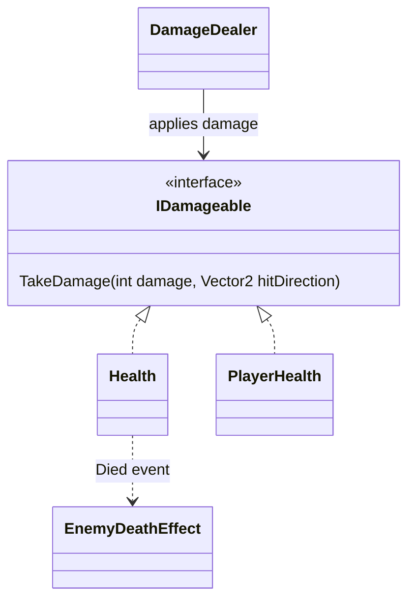
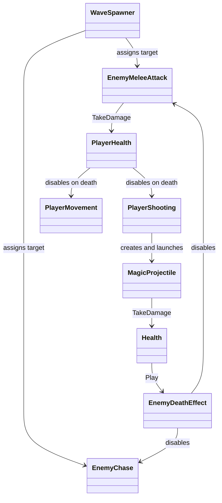
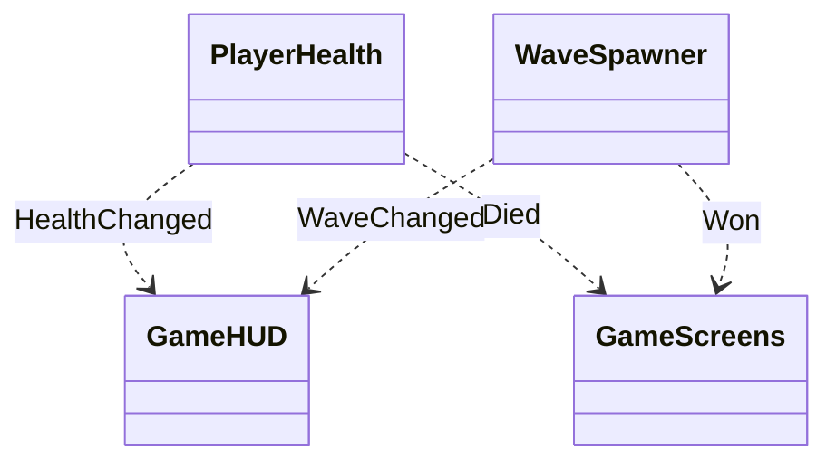

# Architecture Review and AI Usage Journal

**Project:** Frieren: Demon Hunt  
**Review date:** 16 November 2026  
**Scope:** Forest combat prototype, eleven scripts under `Assets/Scripts`.

## 1. Purpose and method

This document records an AI-assisted comparison between a reference class design and the implemented prototype, including differences and their tradeoffs. It also records how AI supported physics explanations, graphics, implementation, and documentation.

The reference diagram below was prepared retrospectively during the review. It is a design model for comparison, not a diagram claimed to have been created before implementation. The comparison therefore identifies differences from that model rather than proving changes from an earlier historical plan.

The review inspected the scripts' responsibilities, damage calls, event declarations and listeners, target assignment, death effects, and configurable values. This is a static code review; it does not replace testing the game.

## 2. Reference design

The reference model proposes a common damage contract and event-driven enemy death effects.

`DamageDealer` represents an attack role in this reference model, not an implemented class. Neither `IDamageable` nor the enemy `Health.Died` event exists in the current code. The player already has a separate, implemented `PlayerHealth.Died` event.

## 3. Implemented relationships

### Combat and spawning

Arrows represent direct calls or component dependencies.

`WaveSpawner` instantiates the enemy prefab and assigns its scene target. `PlayerMovement` handles keyboard movement, while `PlayerShooting` handles mouse aiming and projectile creation. Enemy pursuit and melee attacks are separate components.

On lethal enemy damage, `Health` calls `EnemyDeathEffect.Play(hitDirection)`. The effect disables attacks, pursuit, and colliders, then applies spin and knockback before delayed destruction.

### Gameplay-to-UI events

These arrows represent notifications, not gameplay references to UI objects.

| Publisher | Event | Subscriber | Response |
|---|---|---|---|
| `PlayerHealth` | `HealthChanged(current, maximum)` | `GameHUD` | Updates the HP label |
| `PlayerHealth` | `Died()` | `GameScreens` | Shows the defeat panel |
| `WaveSpawner` | `WaveChanged(current, total)` | `GameHUD` | Updates the wave label |
| `WaveSpawner` | `Won()` | `GameScreens` | Shows the victory panel |

Both UI components subscribe in `OnEnable` and unsubscribe in `OnDisable`. The HUD also reads current values on activation and in `Start`, so displaying the initial state does not depend on receiving a previous event.

## 4. Differences found and their reasons

The reasons below describe the tradeoffs of the implemented prototype. They are retrospective explanations, not a claim that these decisions were documented before coding.

| Area | Reference model | Existing implementation | Reason and consequence |
|---|---|---|---|
| Damage contract | Player and enemy health share `IDamageable`. | `MagicProjectile` calls `Health.TakeDamage(int, Vector2)`; `EnemyMeleeAttack` calls `PlayerHealth.TakeDamage(int)`. There is no shared interface. | Separate components make player immunity and enemy death handling explicit with little setup for one enemy type. Some health logic is duplicated, and attacks depend on specific health classes. A common interface would help when adding more damage sources. |
| Enemy death notification | `Health` publishes an event that the death effect subscribes to. | `Health` directly finds and calls `EnemyDeathEffect`; without it, the enemy is destroyed immediately. | The direct call keeps ownership of delayed removal clear. It also couples enemy health to the effect class. An event would support additional listeners, but would need explicit ownership of destruction and transmission of the hit direction. |

These differences are present in the code; the proposed abstractions are not described as implemented features.

## 5. Architecture checks

| Requirement or principle | Review finding |
|---|---|
| Folders organized by responsibility | Scripts are grouped under Player, Combat, Enemies, Stage, and UI. |
| Focused components | Movement, shooting, pursuit, attacks, health, death effects, waves, and presentation are separate scripts. |
| Event communication | Four gameplay events connect publishers to UI listeners. |
| Gameplay does not reference UI code | Health and wave components publish events; UI holds references to gameplay publishers. |
| Subscription cleanup | UI listeners unsubscribe in `OnDisable`. |
| Tunable data separate from logic | Gameplay values use serialized Inspector fields. Aim tolerance and spin probability use named constants; blink settings use Inspector fields. |
| Singletons and static state | The eleven scripts contain no custom singleton instances or mutable custom static fields. Named constants are used for fixed meanings. |
| Global pause state | `GameScreens` changes Unity's `Time.timeScale`, restoring it on restart and destruction. Input components are disabled separately because `Update` still runs while time is paused. |

The spawner currently assumes one enemy prefab with `EnemyChase` and `EnemyMeleeAttack`. A compatible melee variant can reuse these components. A different attack type would require changes to target setup in `WaveSpawner` and attack shutdown in `EnemyDeathEffect`.

## 6. AI usage journal

AI assistance was used throughout development as a learning, implementation, and review tool.

| Area | How AI was used |
|---|---|
| Physics explanations | To explain topics I was less familiar with: Rigidbody2D movement, colliders, collision callbacks, velocity versus force, and the meaning of AddForce and AddTorque. |
| Physics setup and debugging | To suggest component settings, explain why the player collider belongs near the feet, troubleshoot duplicate physics components on a projectile, and explain collision layers for borders and projectiles. |
| Death response | To help implement and explain a lethal-hit effect combining rotational torque, directional force, and delayed removal. |
| Graphics | To generate prototype sprites for characters, enemies, projectiles, environment objects, and effects, and explain transparency, import settings, filtering, scaling, and visual placement. Assets were selected and arranged manually in Unity. |
| Gameplay implementation | To draft and explain scripts for movement, aiming, projectiles, health, melee enemies, death effects, and wave progression. The scripts were added and connected manually in the Editor. |
| UI and events | To explain C# events and help connect the HUD and opening/result panels while keeping gameplay independent of UI classes. |
| Documentation and review | To add English code comments, draft the README and class diagrams, compare the reference model with the current code, and identify unnamed numeric values. |
| Build and publishing | To explain Web build packaging, Git and pull-request steps, and troubleshoot the HTML canvas dimensions for the Itch.io upload. |

The developer integrated the suggested code, configured scene and prefab references, adjusted colliders and sizes, and tested the resulting behavior. AI-generated suggestions were checked in the project and revised when they did not match the scene setup.

## 7. Validation and follow-up

The developer reported successful manual checks of movement, obstacle and border collisions, shooting, enemy damage, player damage and immunity, wave progression, opening and result screens, and restarting. The published Web version was also checked after correcting its canvas aspect ratio. These are developer-reported checks, not automated tests performed by this architecture review.

The current scope is one arena with melee enemies. Enemy movement uses direct pursuit rather than obstacle-aware pathfinding. A shared damage interface or enemy-death event may be useful in an expanded version; neither is required solely to make this implementation match the reference model.

This file combines the architecture comparison with its AI usage journal entry. If the course uses a separate central journal, include or link this entry there as well.
