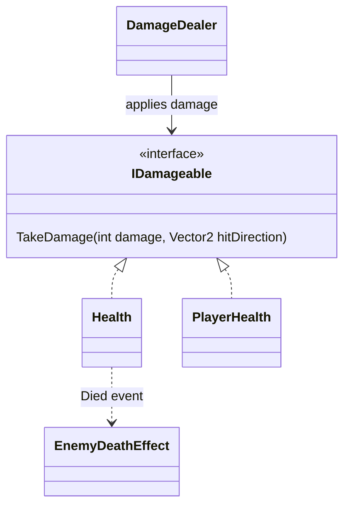

# Architecture Review

## Purpose

This review compares the implemented prototype with a small reference design prepared after implementation.

It documents actual structural differences and their tradeoffs. It does not claim that the reference diagram existed before coding.

The review is based on the eleven gameplay and UI scripts under `Assets/Scripts`.

## Reference design

The reference model proposes:

1. A shared damage interface for player and enemy health.
2. An enemy-death event that the death effect subscribes to.

`DamageDealer` represents a proposed attack role, not an existing class. `IDamageable` and the enemy `Health.Died` event are also proposals.

The actual `PlayerHealth.Died` event already exists and is separate from the proposed enemy event.

## Differences from the implementation

| Area | Reference design | Actual implementation |
|---|---|---|
| Damage contract | Player and enemy health implement `IDamageable`. | Projectiles call `Health.TakeDamage(int, Vector2)`. Melee attacks call `PlayerHealth.TakeDamage(int)`. No shared interface exists. |
| Enemy death communication | `Health` publishes a death event, and the effect subscribes. | `Health` directly finds `EnemyDeathEffect` and calls `Play(hitDirection)`. Without the effect, it destroys the enemy immediately. |

## Tradeoffs

### Separate health components

The current structure makes player immunity and enemy death behavior explicit and keeps the prototype small.

However, some health logic is duplicated, and damage sources depend on a specific health component. A shared interface would become useful when introducing more attack types or damageable objects.

### Direct enemy death-effect call

The direct call provides a clear path from lethal damage to the effect and delayed removal, with little setup.

However, enemy health depends on the effect type. A death event would allow additional listeners, but the design would need to specify who destroys the enemy and how the hit direction reaches listeners.

These are retrospective explanations of the tradeoffs, not a record of decisions made before implementation.

## Principles already reflected in the code

- Components and folders are separated by responsibility.
- Gameplay-to-UI communication uses events.
- Event subscriptions are paired with cleanup in `OnDisable`.
- Gameplay values can be adjusted through the Inspector.
- Wave progression belongs to `WaveSpawner`, rather than a general manager responsible for every system.

## Conclusion and possible follow-up

The current implementation is sufficient for the prototype's limited scope. Refactoring solely to match this reference diagram is unnecessary.

Consider a shared damage interface when adding more damage sources. Consider enemy-death events when several systems need death notifications, with explicit ownership of object removal.

For the AI usage journal, describe this work as an AI-assisted retrospective architecture comparison.