

# Frieren: Demon Hunt — אפיון משחק 

 שלושה גיבורים. שלוש דרכי לחימה. מסע אחד נגד השדים.

> **סטטוס:** מסמך תכנון ראשוני לפרויקט לימודי, לא תיאור של משחק שכבר פותח. החלטות המכניקה המפורטות להלן הן הצעות לתכנון וניתן לשנות אותן בעקבות אבטיפוס ובדיקות משחק.

## מהות המשחק

המשחק *Frieren: Demon Hunt* הוא משחק תפקידים ופעולה דו־ממדי (**2D Action RPG**) המבוסס על משימות, במבט עילי או איזומטרי (**Top-down**) ובתנועה חופשית בזירת הקרב. המשחק מתרחש בעולם של *Frieren: Beyond Journey's End*. השחקן מקבל משימות לציד שדים בטברנה, בוחר אחת משלוש דמויות — פרירן, פרן או סטארק — ויוצא לזירת קרב. לכל דמות סגנון לחימה ייחודי: פרירן מתמחה בקסמים חזקים ואיטיים, פרן בקסמים מהירים ורציפים, וסטארק בלחימת גרזן מטווח קרוב. לאחר ניצחון בקרב, השחקן מקבל תגמולים המאפשרים לשדרג את הדמויות ולפתוח משימות מאתגרות יותר. בנוסף, היכולות המיוחדות של הדמויות משלבות אירועי תגובה מהירה (**QTE**) קצרים, שבהם דיוק בתזמון משפיע על עוצמת המתקפה.
**פלטפורמה:** מחשב אישי (Windows), שליטה במקלדת ובעכבר; הפרויקט מתוכנן לפיתוח ב-Unity.

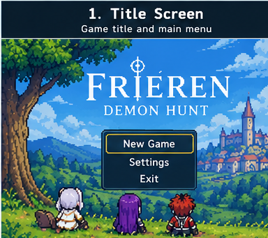

---

## רכיבים רשמיים

### 1. שחקנים

המשחק מיועד לשחקן **יחיד**, בעיקר לחובבי משחקי פעולה דו־ממדיים, קרבות בזמן אמת ופנטזיה/אנימה. קהל היעד המוצע הוא בני נוער ומעלה, עם נגישות למתחילים לצד מקום לשיפור מיומנות בתזמון, התחמקות ולמידת דפוסי אויבים. אפשר יהיה לשחק שוב במשימות עם דמויות שונות כדי להתנסות בסגנונות לחימה אחרים.

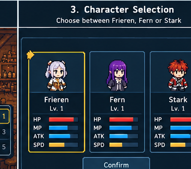

### 2. יעדים

המטרה בכל משימה היא **להביס את כל האויבים הנדרשים** (או את הבוס) תוך שמירה על לפחות נקודת חיים אחת. לאחר השלמת משימות מתקבלים תגמולים המשמשים לשדרוג הדמויות. מטרת הדמו כולו היא להשלים **שתי משימות מול קבוצות אויבים** ומשימה שלישית מול **בוס בעל דפוסי התקפה נלמדים**.

היעד יוצג בטברנה בתיאור המשימה, ובמהלך הקרב דרך טקסט קצר כגון “הבס את כל השדים”, מונה אויבים ומד חיים לבוס לפי הצורך. הצלחה או כישלון יוצגו במסך סיום ברור.
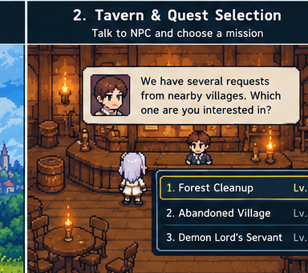

### 3. תהליכים

**תחילת המשחק — 30 השניות הראשונות:** השחקן רואה טברנה עם לוח משימות בולט. לחיצה על הלוח פותחת רשימת משימות קצרה. לאחר בחירת משימה מופיע מסך בחירת דמות עם הסבר של שורה על כל סגנון לחימה. השחקן נכנס מיד לקרב ומקבל הוראות שליטה קצרות על המסך. המטרה היא להתחיל בפעולה במהירות, ללא דיאלוגים ארוכים.

**תהליך הליבה:** בטברנה בוחרים משימה ודמות → בזירה נעים עם WASD, מכוונים בעזרת העכבר ותוקפים בלחיצה שמאלית → מתחמקים ממתקפות אויב ומשתמשים ביכולת מיוחדת, לדוגמה בלחיצה על Q → בזמן יכולת מיוחדת עשוי להופיע QTE קצר, והצלחתו מעניקה בונוס למתקפה → לאחר ניצחון חוזרים לטברנה ומנצלים תגמולים לשדרוג דמות לפני המשימה הבאה.

**תהליך הסיום:** המשימה מסתיימת כאשר כל האויבים הובסו או כאשר מד החיים של הבוס הגיע לאפס. מסך ניצחון מציג תגמול ואפשרות חזרה לטברנה. אם מד החיים של השחקן מגיע לאפס, מוצג מסך הפסד ואפשרות לנסות שוב. לאחר ניצחון על הבוס השלישי מוצג מסך השלמת הדמו אם כי בהרחבה של המשחק יהיה ניתן להמשיך ולהתקדם מעבר.

**פקדים מוצעים:** WASD לתנועה, עכבר לכיוון, לחיצה שמאלית להתקפה רגילה, Q ליכולת מיוחדת, Space להתחמקות; ב-QTE מופיעים מקשים מוגדרים שעליהם יש ללחוץ בחלון זמן קצר. אלה פקדים מוצעים וייתכן שישתנו בבדיקות המשחק.

**לימוד התהליכים:** הוראות קצרות בזמן הקרב הראשון, רמזים ליד היכולות ומסך עזרה נגיש. אין צורך במדריך נפרד וארוך.

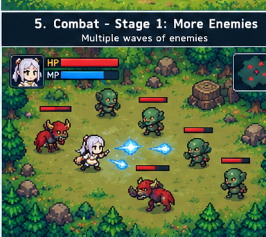

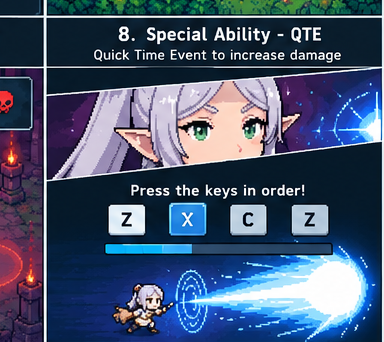

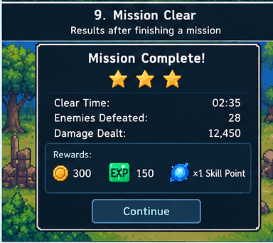

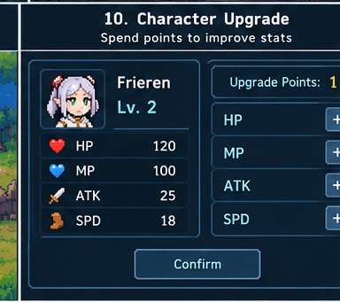

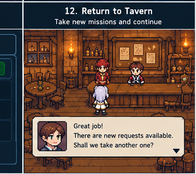

### 4. חוקים

- לכל דמות יש מד חיים. כאשר הוא מתרוקן המשימה נכשלת.
- אפשר לנוע רק בתחומי הזירה; לא ניתן לצאת ממנה במהלך קרב.
- לכל דמות התקפה רגילה ויכולת מיוחדת; יכולת מיוחדת צורכת משאב (Mana אצל הקוסמות, Stamina אצל סטארק) ו/או כפופה לזמן המתנה, בהתאם לאיזון שייקבע.
- נזק נקבע לפי נתוני הדמות, סוג המתקפה ופגיעה בפועל באויב; לא כל מתקפה פוגעת אוטומטית.
- התחמקות מתוזמנת מאפשרת להימנע מחלק מהמתקפות, בכפוף לכללי היכולת שייקבעו באבטיפוס.
- QTE מוצלח מעניק בונוס להתקפה המיוחדת; כישלון ב-QTE אינו חייב לבטל לגמרי את המתקפה, כדי לא להעניש באופן חד מדי.

החוקים יילמדו דרך סימונים בממשק, אנימציות, מדדי משאבים, הדגשת אזורי סכנה והתנסות בקרב הראשון.

### 5. משאבים

**HP (חיים):** מאפשר להמשיך בקרב; פגיעה מאויבים מפחיתה אותו. **Mana / Stamina:** משמש להפעלת יכולות מיוחדות; ניתן לחדש אותו לאורך זמן או באופן שייקבע באיזון. **מטבעות או נקודות שדרוג:** מתקבלים לאחר הצלחת משימה ומושקעים בשיפור HP, Damage, Movement Speed וקיבולת משאב היכולת של דמות מסוימת.

כדי לשמור על בחירות מעניינות, כל משימה תעניק מספר מוגבל של נקודות או מטבעות; עלויות השדרוג עשויות לעלות בהדרגה. אם מאפשרים לשחק שוב במשימה לצורך תגמולים, יש להגביל את קצב הצבירה כדי ששדרוגים לא יהפכו לבלתי מוגבלים לפני הבוס.

ממשק הקרב יציג חיים ומשאב יכולת; בטברנה יוצגו המטבעות/נקודות השדרוג וסטטיסטיקות הדמות הנבחרת.

### 6. עימותים

**שחקן מול המערכת:** שדים שמנסים לפגוע בשחקן, אויבים המתקרבים מטווח קצר ואויבים תוקפים מרחוק, וכן בוס עם התקפות שניתן ללמוד ולזהות מראש. **שחקן מול עצמו:** בחירת הדמות המתאימה למשימה, החלטה מתי להשתמש ביכולת מיוחדת, לאן להתחמק ובאילו סטטיסטיקות להשקיע.
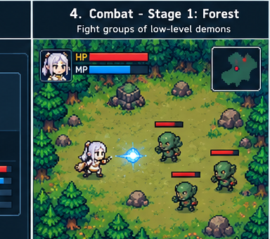

### 7. גבולות

העולם הוא **סגור ומבוסס זירות**: הטברנה משמשת כמרכז לבחירת משימות ושדרוגים, וכל משימה מעבירה את השחקן לזירת קרב מוגדרת. המרחב הוא דו־ממדי ו**שטוח** מבחינת התנועה, גם אם המבט והגרפיקה מעניקים תחושת עומק איזומטרית. הזירות תחומות בקירות, סלעים, עצים או גבולות סביבה ברורים, שאין מעבר דרכם.

**עקרונות תכנון המפה:**
- **משמעות:** כל זירה נראית ומתנהגת בהתאם לסוג המשימה (יער, כפר נטוש, זירת בוס).
- **ניידות:** נתיבים פנויים לתנועה ולהתחמקות, בלי מכשולים שמקשים באופן לא הוגן על קרב.
- **התמצאות:** גבולות נראים היטב; מיקום השחקן, האויבים והסכנות ברור.
- **עניין:** הבדלים חזותיים בין הזירות, סוגי אויבים שונים וסימוני מתקפות.
- **הכוונה:** לוח משימות ברור בטברנה, התראות קרב וסימונים חזותיים להתקפות הבוס.

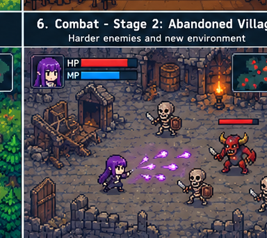

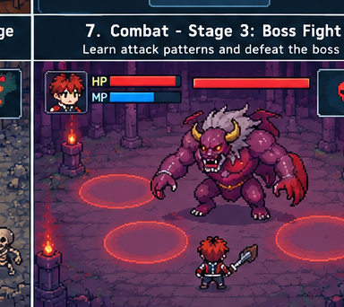

### 8. תוצאות

לכל משימה יש שתי תוצאות בסיסיות: **ניצחון** (הבסת האויבים וקבלת תגמול) או **הפסד** (אובדן כל החיים וניסיון חוזר). לדמו כולו יש סיום לאחר השלמת משימת הבוס. התוצאה תלויה בעיקר **במיומנות השחקן** — תזוזה, תזמון, הבנת דפוסי אויבים וניצול יכולות — ולא במזל. בגרסת הדמו אין יריבים אנושיים ואין משחק סכום־אפס בין שחקנים; זהו משחק פעולה לשחקן יחיד נגד המערכת.

---

## סקירת משחקים קיימים

**ביטויי חיפוש לדוגמה:** `top-down action RPG multiple characters`, `2D fast paced spell combat game`, `mission based arena action RPG`, `isometric pixel art dungeon combat`.

### 1. Children of Morta

**קישור:** https://store.steampowered.com/app/330020/ChildrenofMorta/

דמיון: משחק Action RPG דו־ממדי עם דמויות שונות, שלכל אחת יכולות וסגנון לחימה משלה. השחקן יכול לבחור בין דמויות למשימות/ריצות, ויש התקדמות של דמויות לאורך זמן.

**ייחוד המשחק שלנו:** מבנה קצר וממוקד של משימה בטברנה → זירת קרב, שלוש דמויות מסוימות מעולם פרירן, ומכניקת QTE במתקפות מיוחדות במקום התמקדות בחקירת מבוכים.

### 2. Wizard of Legend

**קישור:** https://wizardoflegend.com/press/wizard_of_legend/index.html

דמיון: לחימה מהירה במבט מלמעלה, שימוש בקסמים, התחמקות ועימותים מול אויבים ובוסים.

**ייחוד המשחק שלנו:** בחירה בין שלושה סגנונות שונים מאוד, כולל לוחם גרזן מטווח קרוב; חזרה לטברנה בין משימות; QTE קצר שמאפשר ביצוע מוגבר של יכולות מיוחדות.

### 3. Archero

**קישור:** https://play.google.com/store/apps/details?id=com.habby.archero

דמיון: זירות/שלבים עם אויבים רבים, התחמקות מפרויקטים ומתקפות, התקדמות דרך קרבות ושדרוג הסטטיסטיקות.

**ייחוד המשחק שלנו:** שליטה אקטיבית בשיטות תקיפה שונות של שלוש דמויות, בחירת משימה ודמות בטברנה, ומיומנות תזמון ייעודית דרך מתקפות מיוחדות עם QTE.

**הרכיבים המדגישים במיוחד את הייחוד:** **שחקנים** (בחירת דמות מובחנת), **תהליכים** (משימות קצרות עם לופ טברנה–קרב–שדרוג), **חוקים** (QTE במתקפות מיוחדות) ו**עימותים** (קרבות בוס המצריכים זיהוי דפוסים).

---

## היקף הדמו והתפתחות עתידית

**מטרות הדמו:** שלוש דמויות לבחירה; טברנה עם לוח משימות ושדרוגים בסיסיים; שתי משימות קרב נגד קבוצות אויבים; משימת בוס אחת; לפחות שני סוגי אויבים רגילים; יכולת מיוחדת אחת ו-QTE בסיסי לכל דמות; מסכי ניצחון והפסד.

**הרחבות אפשריות בעתיד (לא חלק מההתחייבות לדמו):** החלפת דמויות בזמן קרב, עולם לחקירה, מערכות לבוש קוסמטי, עוד יכולות, זירות ובוסים, מערכות ציוד מורכבות או משחק מרובה משתתפים.

**סדר פיתוח מומלץ:** (1) אבטיפוס עם דמות אחת ואויב אחד, (2) התקפה/התחמקות ותחושת קרב, (3) אויבים ובוס עם דפוסים, (4) שתי הדמויות הנוספות, (5) לופ טברנה–משימות–תגמולים, (6) QTE ושיפורים גרפיים. הסדר ניתן להתאמה לפי חלוקת העבודה בצוות.

**הערת שימוש בזכויות:** המשחק מבוסס על דמויות ועולם קיימים ולכן מתאים להצגה כאבטיפוס לימודי לא מסחרי בלבד; הפצה פומבית או מסחרית עלולה לדרוש אישור מבעלי הזכויות. חלופה להמשך היא החלפת הדמויות והעולם בתוכן מקורי תוך שימור המכניקות.

**תמונות ההמחשה:** התמונות במסמך זה נוצרו בעזרת כלי AI לצורך המחשה בלבד. הן אינן חלק מפרויקט קיים אלא קונספט ויזואלי של המשחק

